# Spendly

**A personal ledger for what you buy.** Capture a receipt, keep every order and its lines straight,
see where the money went per month, vendor and category, plan the year in a budget, and keep a list
of things worth buying later.

Spendly runs on your own server, in one container, with your data in one folder. Each person has
their own account, and nobody sees another account's records. Formats are Danish by default
(kroner, day-first dates, decimal commas) and every account can choose its own.

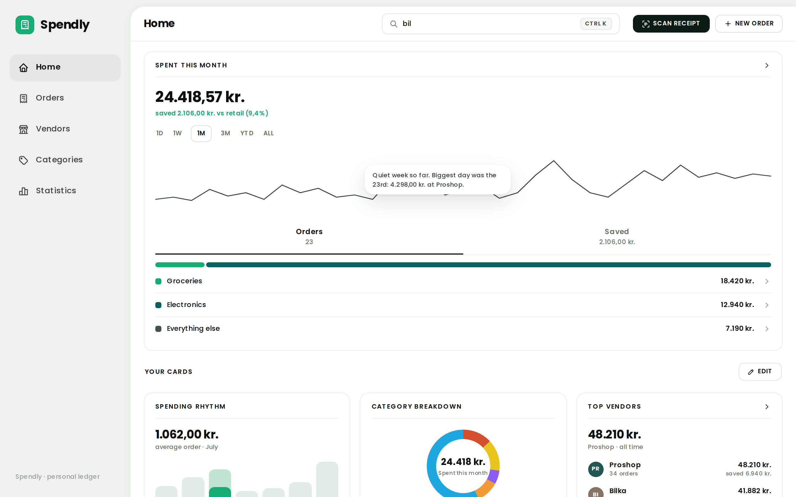

## Contents

- [Features](#features)
- [Running it](#running-it)
- [Stack](#stack)
- [How it is built](#how-it-is-built)
- [Working on it](#working-on-it)
- [The design system](#the-design-system)

## Features

### Home

Everything that needs you, on one page.

- **This month** - what you spent, what you saved, how many orders, and how far into the month you
  are, measured against last month or the same month last year.
- **Needs a look** - categories over or near their limit, orders still "Ordered" after two weeks,
  vendors that look like duplicates, and orders without a receipt. Each one opens the matching
  list. Each rule can be turned off in Settings.
- **Last month in review** - from the 1st of each month: which categories went over, how often,
  and when a limit may be too low.
- **Recent orders and drafts** - a scanned receipt shows as a draft once you have changed it.
- **Add an order** - drop a receipt, start an empty order, or copy an earlier one.
- **Top categories** with their limit bars, and **the last 8 months** as a chart. A click opens
  Statistics at that point.

### Orders

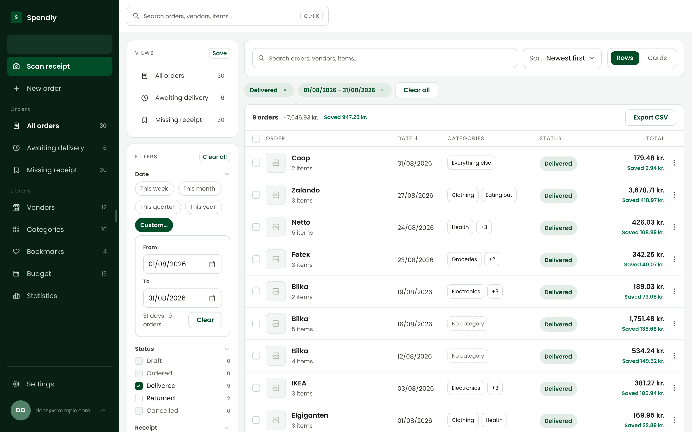

- **Search** by vendor (and its other names), item, note or reference.
- **The search reads what you type.** An amount ("over 500", "under 200", "500-1000"), a period
  ("this month", "last month", "august", "2025") and the full name of a vendor or a category each
  become a filter tag while you type. The other words are searched as text. Removing a tag removes
  its words, and deleting the words removes the tag.
- **Ask in the search.** The button at the end of the search, or Alt+A, switches it to Ask. Type a
  sentence such as "groceries over 500 last month" and press Enter, and Ask sets the filters for it.
  It uses one of the day's Ask questions. The button is not there when Ask is not set up.
- **Filters** for date, status, receipt attached or missing, vendor, category, kind (expense, gift,
  sold, work, other), amount, attachments and discounts. Every filter shows a live count, and
  each active one shows as a tag you can remove.
- **Sort** by date, total or vendor, and show orders as **rows or cards with photos**.
- **Saved views** keep a search, filters, sort and layout. Save, rename, reorder, set a default
  view, highlight a view's count, and see them in the sidebar with live counts.
- **Work on many at once** - set a status, add a category, export or delete, with undo for status
  and category changes.
- **Export** what you see as a spreadsheet file (CSV, ready for a Danish spreadsheet).
- **Reconcile** - load your bank's CSV or Excel file and see which payments have no order, and which
  orders have no payment. Set how many days and how much of a difference a match may have. Pick a
  vendor for a payment, and Spendly creates the order from it.
- **Statuses** - Draft, Ordered, Delivered, Returned and Cancelled are built in. Add your own in
  Settings.

### One order

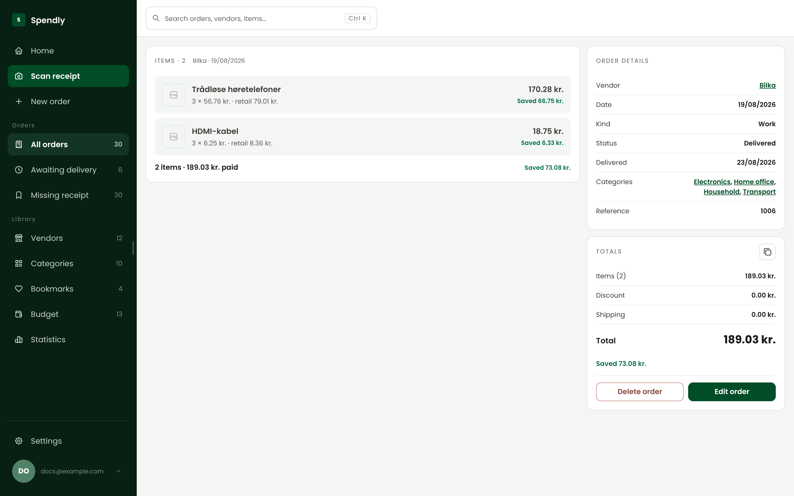

- Items with photos, quantities, prices and retail prices, so every line shows what you saved.
- Details: vendor, date, kind, status and its date, categories, reference and note.
- Totals: items, discount, shipping, total and saved.
- **Attachments** - receipts, photos and PDFs, in a viewer with zoom, swipe and every page of a
  PDF.
- **Leave out of statistics** - for an order that should be listed but not counted.
- **Duplicate, edit or delete.** A deleted order can be brought back from the message that follows.
- **While you edit:**
  - Lines can be reordered by dragging or with the arrow keys, duplicated, and given a photo (pasting works).
  - Category suggestions come from your own earlier orders.
  - A warning shows before a save takes a category over its limit. It never blocks the save.
  - Unsaved changes are never lost by accident.
  - A change made on another device is shown, and you choose which to keep.
  - A save made without internet is sent when the connection comes back.
- **Compare with the receipt** - when you add a receipt to a saved order, see every line that
  differs, pick the receipt or the order for each, and the order is marked as checked.

### Adding orders

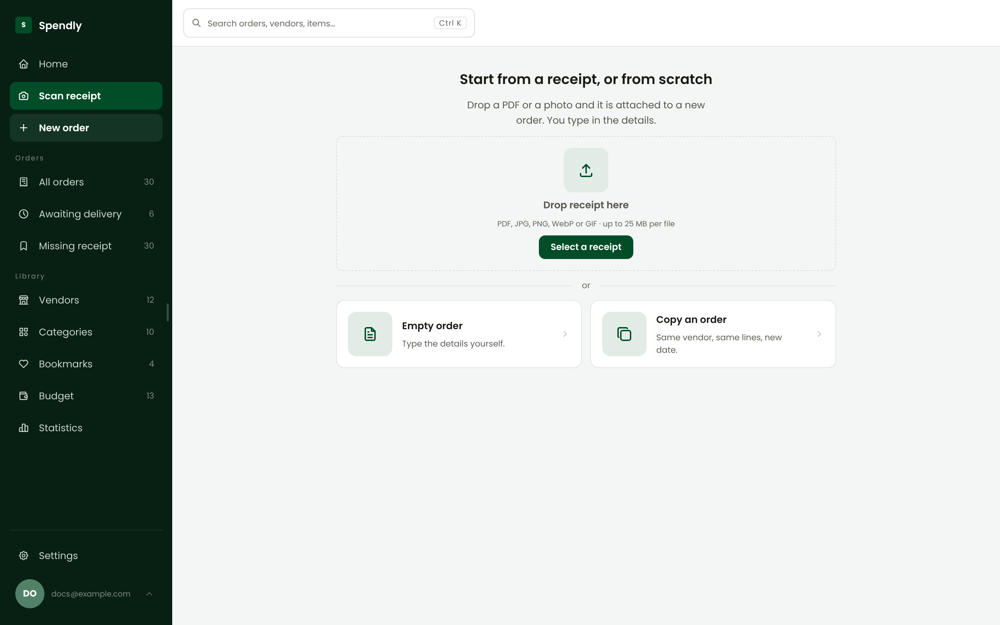

- **Scan a receipt** - drop a photo or a PDF (up to 25 MB). Spendly reads the vendor, date,
  currency, VAT, shipping, discount, total, order number and every line, and drafts the order.
  - Amounts are turned into prices with VAT included.
  - A receipt in another currency is converted at that day's rate.
  - The review step points at what needs a look, and lets you pick which lines to keep.
  - The kind of document sets the status: a receipt is Delivered, an order confirmation is Ordered,
    a return is Returned.
  - The vendor is found by VAT number, web address or name, and a new name it was printed with is
    saved as one of its other names.
  - A file that is already on an order or in a draft is recognised before it is read again.
- **Empty order** - type it in yourself.
- **Copy an order** - same vendor, same lines, today's date. Orders you repeat often are listed
  first.
- **Already have it?** - when a scanned, new or edited order repeats one you have, by the same file
  or by the same vendor, a near date and a near total, one question asks first. You can open the
  order you have in a new window, create or save anyway, or discard.
- **Drafts** - an order you start or scan is kept as a draft from your first change, so you can come
  back to it.
- **Import** - bring in many orders at once from a spreadsheet (CSV, XLSX or JSON). See
  [Settings](#settings).

### Search and keyboard

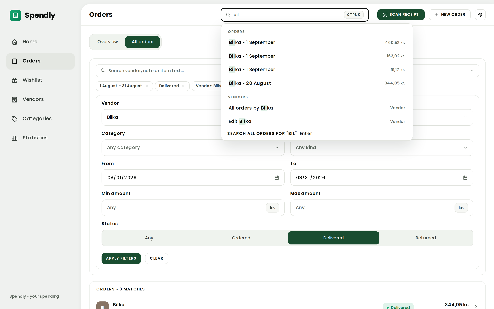

- **One search for everything** - press Ctrl K (⌘ K on a Mac) or just start typing. It finds
  orders, vendors and items, offers "New order for ..." and "See ... in Statistics", lists what you
  opened last, and runs actions like scan, import or dark mode.
- **Keyboard shortcuts** - S scans, N starts a new order, G then O, V, C, B, T, A or S goes to Orders,
  Vendors, Categories, Budget, Statistics, Ask or Settings, and ? shows them all.
- **Paste a picture anywhere** and it goes where the page takes one.

### Statistics

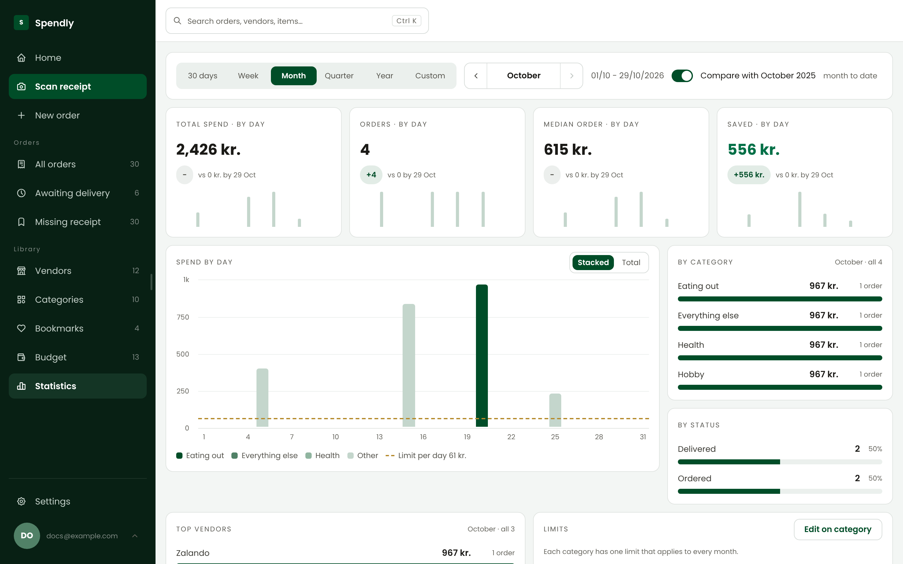

- **Periods** - 30 days, week, month, quarter, year or your own dates, with shortcuts for this
  month, last month, year to date and all time. Step to the previous or next period with the arrows
  beside its name, or with the left and right arrow keys.
- **Count** expenses only, refunds only, or net of refunds, and compare with the same period a year earlier.
  A returned order and an order of the kind Sold are money back; every other order is money paid.
- **Figures** - total spend, orders, median order and saved, each with its change.
- **Charts and breakdowns** - spend over time, stacked by category; by category, status and vendor;
  spend against saving; and how each limit is doing.
- **Drill down** - click a month, a category, a vendor or a status to look closer, up to three
  steps, and open the orders behind any view.

### Budget

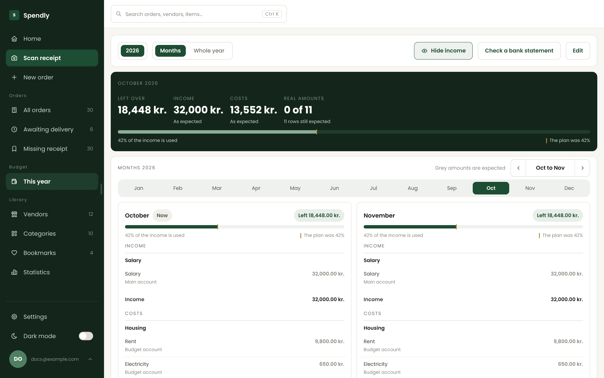

- **A yearly plan** with income and costs, in groups and rows, with an expected amount for each
  month and the real amount once you know it.
- **Months or the whole year** - one month in front with what is left over and how much of the
  income is used, or the whole year as a sheet. Press a month to move to it, or use the left and
  right arrow keys.
- **Start next year** as a copy of this one, or **import** a year from Excel.
- **The sidebar counts this month's payments** - every cost row with an amount this month, paid or
  not.
- **Reconcile** - load your bank's CSV or Excel file and Spendly matches each payment against
  the budget, then saves the real amounts. The file is read in your browser and never sent
  anywhere. It works with any bank's export. A payment you place on a row is remembered for later
  files, in every year made as a copy, and after the row is renamed.

### Vendors and categories

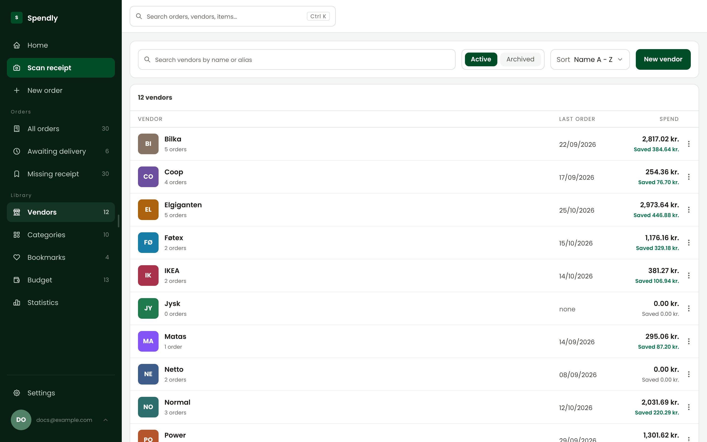

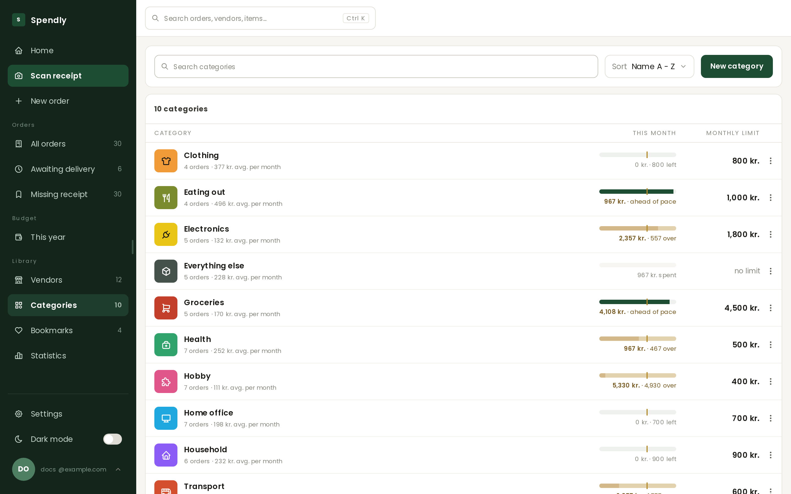

- **Vendors** - search, sort, archive, and merge two into one. A vendor has a
  picture, a colour, other names it matches on receipts, default categories, and "Leave out of
  statistics" for one-off shops. **Possible duplicates** are found by name or VAT number.
- **Categories** - an icon from a large library, a colour, and a **limit** for each month or for the
  whole year. Each row shows this month or this year against its limit. Spendly warns you when a
  monthly limit you type would have been passed in most of the last 12 months.
- **Spend** for a vendor or a category is money paid, as in Statistics' "Expenses only". A returned
  order and an order of the kind Sold are listed and counted as orders, but add nothing to it. The
  same holds for the total over the order list.
- **Category suggestions** come from a small language model that runs on your own server and
  learns from your own orders.

### Bookmarks

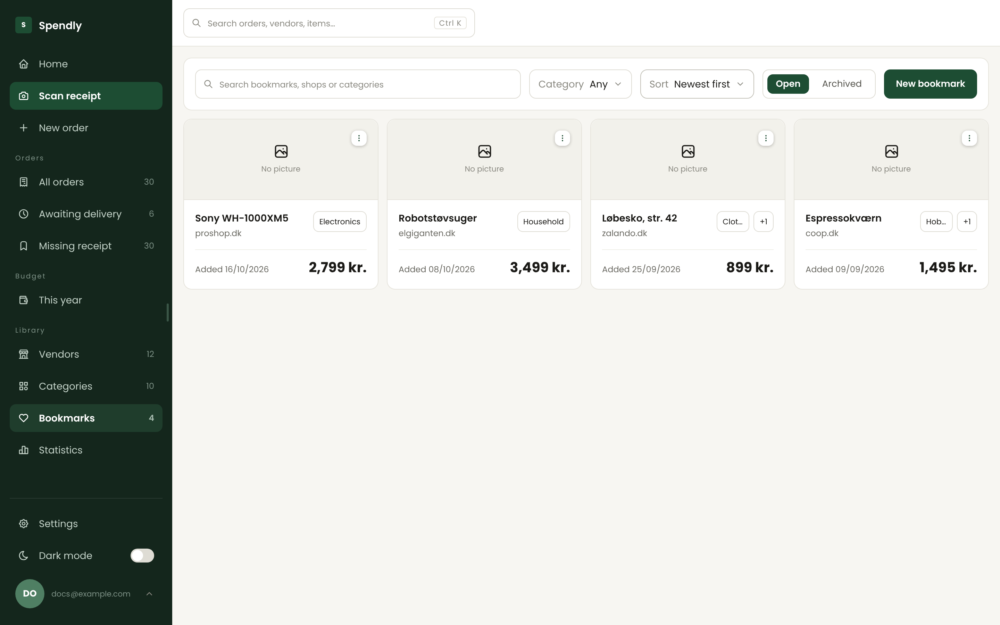

- Things worth buying later, with a link, name, price, categories and a picture.
- Paste a link and Spendly reads the page's name and picture for you.
- Search, filter by category, sort, archive.

### Settings

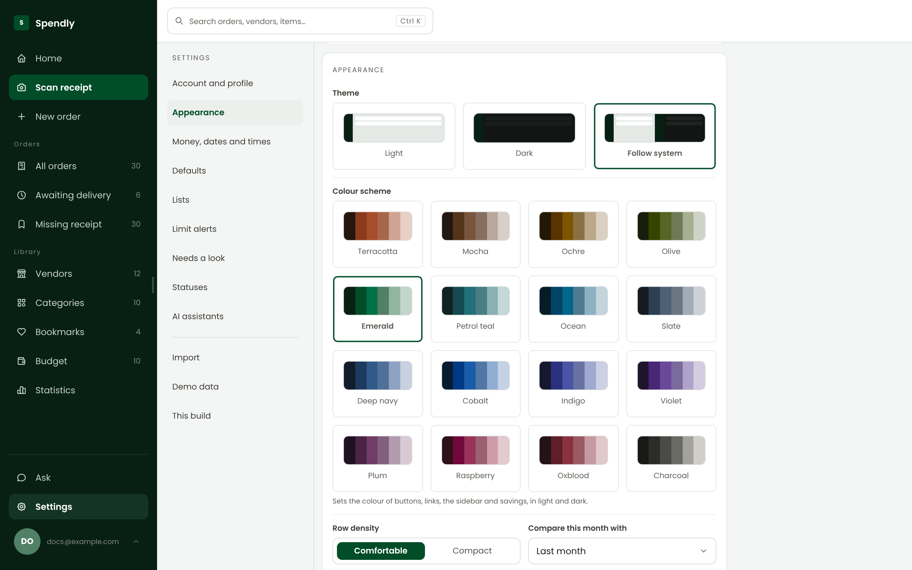

- **Account** - name, picture, password, **passkeys** (fingerprint, face or device PIN),
  **two-step sign-in** (a code from an app on your phone), and **Delete account**.
- **Status email** - a weekly summary, a monthly one or both, of spending, saving, limits, your latest orders and bookmarks.
- **Language and formats** - the language of Spendly's words (English or Danish), currency (DKK, SEK, NOK, EUR, USD, GBP) and date format.
- **Appearance** - light, dark or follow the system; a colour scheme for the app and its emails; comfortable or compact rows.
- **Defaults** for a new order, **lists** (page size, sort, how many saved views and recent
  orders), **limit alerts**, and which **Needs a look** rules show on Home.
- **Statuses** - add, rename, colour and reorder your own.
- **AI assistants** - make and remove the tokens an assistant program reads your account with. See [AI assistants](#ai-assistants).
- **Import** orders from CSV, XLSX or JSON: map the columns, review totals and possible
  duplicates, download skipped rows, and undo an import for 24 hours. A template is included.
- **Demo data** - fill an account with realistic orders and a budget for several years to try Spendly out.
- **This build** - the installed version number, what changed in it and the versions before it, and
  "Update and reload" when a newer one is ready, with what is new in it.

### Light, dark and phone

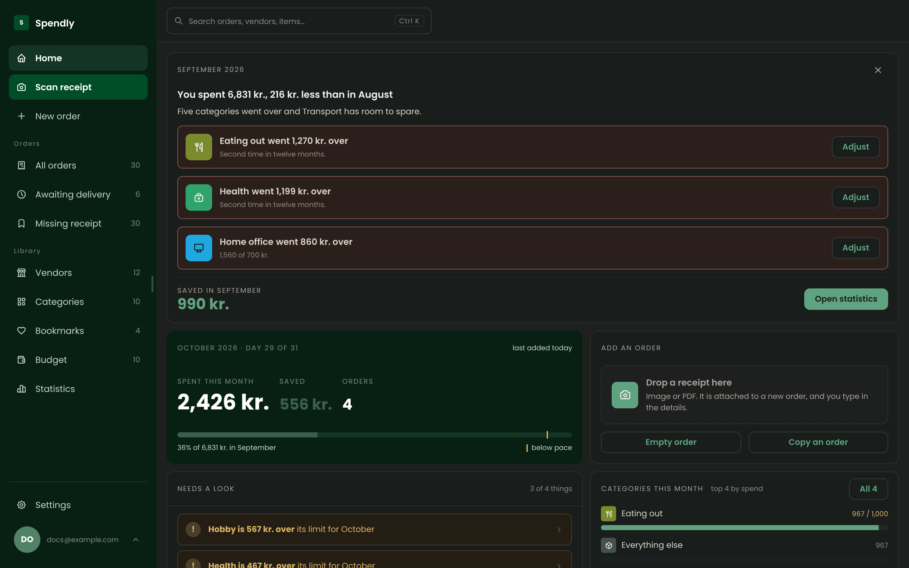

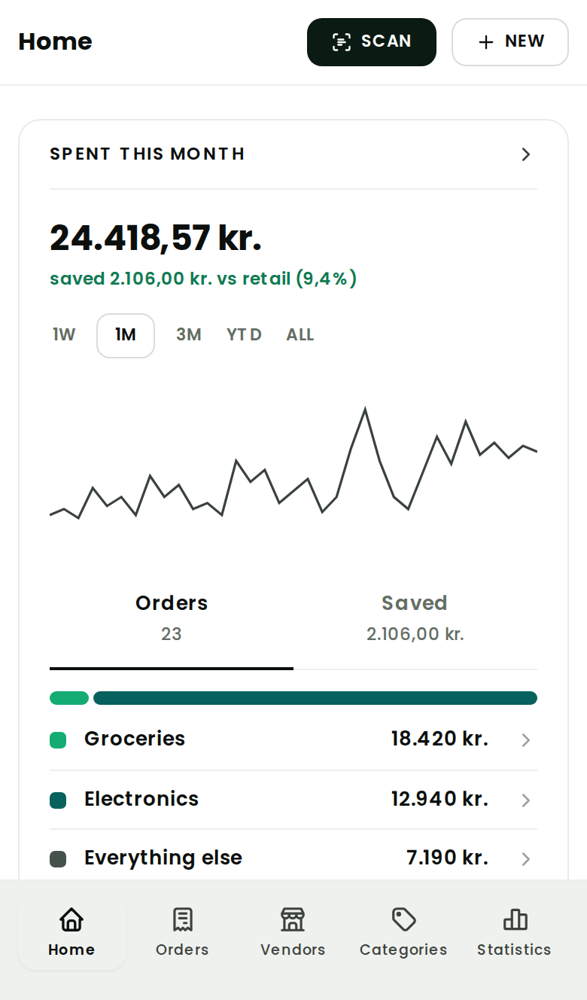

- **Dark mode** everywhere, switched from search or Settings.
- **On a phone** - a tab bar for Home, Orders, Statistics and More, sheets from the bottom for
  filters and choices, full-screen pictures, and touch-sized controls. Hold a finger on an order,
  a vendor, a category or a bookmark to open its menu. Add Spendly to the home screen and it opens
  like an app.
- **Every page remembers where you were**, scroll position included.
- **Things move gently.** Menus, lists, calendars and dialogs open with a short slide and fade,
  figures count to their new value, content fades in where its placeholder stood, and Load more
  slides the page to the first record it brought. A device set
  to reduce motion gets every change at once.

### Accounts and security

- **Sign in** with a password (at least 12 characters, with a strength bar) or a passkey. "Stay
  signed in" lasts 30 days.
- **Email confirmation** and **password reset** by email. You get an email when your password
  changes or a passkey is added.
- **Changing the password** in Settings signs out every other device. A **password reset** signs
  out every device and removes every passkey.
- **Adding a passkey** asks for the password first.
- **Delete account** in Settings asks for the password, and a code when two-step sign-in is on.
  The account and everything in it are removed for good, and every device is signed out. A copy
  of your orders and their receipts can be downloaded first, as a .zip that Import reads.
- **Two-step sign-in** is turned on in Settings, Account and profile: give your password, scan the
  QR code with an authenticator app (or type its key), then type the first code. Signing in with a
  password then asks for the 6-digit code from the app. A passkey sign-in does not.
- **10 recovery codes** are shown once when it is turned on, to copy, write down or download. Each
  works once in place of a code from the app. "New recovery codes" makes a new set, and the old one
  stops working.
- **Turning it off** asks for the password and a code. Turning it on signs out every other device. A
  password reset keeps it on. You get an email when it is turned on or off, and when a recovery code
  signs in.
- **After 5 wrong codes** in 15 minutes, the code step pauses for 5 minutes. The code step lasts 5
  minutes after the password.
- **Lost your phone and your recovery codes?** The person who runs the server types
  `docker exec spendly node api/scripts/two-step-off.mjs you@example.com`. It turns two-step sign-in
  off for that account, signs it out everywhere and sends the email.
- **Every security event is written to the log**: each sign-in, wrong password, wrong code, lock-out,
  refused link, passkey, assistant token, ended session and request from another site, with the
  account, the network address and the browser. A password, code, link or token is never written.
- **After 5 wrong passwords** in 15 minutes from one device, signing in to that email from that
  device pauses for 5 minutes. Each device also has a limit on how often it can try to sign in,
  register or ask for a reset email.
- **If your session ends** while you work, you sign in again on top of the page, and nothing you
  typed is lost.
- **Pictures are cleaned** of location and device details when they are uploaded.
- **Nightly backup** - just before midnight the server keeps a copy of the database, and keeps
  the newest five.

### AI assistants

- **Ask** - ask questions about your money in plain words, and Spendly answers from your own
  orders with amounts, tables, charts and links. It can make a spreadsheet, document, PDF or CSV file
  to download. Chats and files are kept for 30
  days. Ask only reads, never changes anything, and needs `ANTHROPIC_API_KEY` on the server.
- **Assistant programs** such as Claude, Cursor or ChatGPT can read your account through `/mcp`, with
  a token made in Settings, AI assistants. They only read, too.

## Running it

Spendly is one container. [`docker-compose.yml`](docker-compose.yml) runs it on a home server with
HTTPS in front ([Caddy](https://caddyserver.com/)) and automatic updates when a new version is
published ([Watchtower](https://github.com/nicholas-fedor/watchtower)). It also answers plain http
on port 4000 on the home network, for a device that does not trust the certificate. Every setting
in it has a note that says what it does.

```bash
docker compose up -d
```

Then open the address you set, and create the first account.

**Version numbers count themselves.** Each version is three numbers, like `1.4.2`: major, minor and
build. Each change that reaches `main` raises one of them and sets the numbers after it to 0:

- A small change, such as a fix or polish, raises the build number. This is the default.
- A pull request with `[minor]` in its title, or the `minor` label, extends a feature and raises
  the minor number.
- A pull request with `[major]` in its title, or the `major` label, is a new, bigger feature and
  raises the major number.

Each published image is tagged with its version too, so `ghcr.io/mm98/spendly:1.4.2` names one
exact build.

**Each version carries its release notes.** Every change that reaches the app adds one short file to
`.releases/`: up to three plain lines on what the user can now do or see, each with one short sentence
on why it was made, or "No change you can see." The image build gives each file the version of the
change that added it, and carries the notes of the newest 20 versions that have any. A check in CI
stops a change without a note, or a note in technical words. `.releases/README.md` says how to write one.

The app's building blocks, one by one, are at the same address plus `/storybook`. Sign in first.

**Your data is one folder.** The database lives in the folder mounted at `/data`. Back up that
folder and you have backed up Spendly. The files Ask makes are in a second folder, mounted at
`/storage`, with one folder for each account. They are kept for 30 days, so that folder needs no backup.
A copy of the container log is written to a third folder, mounted at `/logs`: one file a day, kept
for 30 days, and at most 50 MB a day. If that folder cannot be written, the app still starts and the
log is only in the container.

**Some features need a setting on the server.** Everything else works without them.

| Setting | Turns on | Without it |
|---|---|---|
| `ANTHROPIC_API_KEY` | Reading receipts, the light-bulb button that suggests categories (it can propose a new one), and Ask | The receipt is attached and you type the details yourself. There is no Ask page. |
| `ANTHROPIC_API_MODEL` | Which Claude model answers on Ask, for example `claude-sonnet-5-5` for better answers at a higher cost | `claude-haiku-5-5`, the cheapest and fastest. |
| `SPENDLY_ASK_QUESTIONS_PER_DAY` | How many questions each account can ask a day (default 25); `0` turns Ask off | 25. |
| `SPENDLY_STORAGE` | Where the files Ask makes are kept, outside the database (`/storage` in the container) | A `storage` folder beside the database. |
| `SPENDLY_LOGS` | A copy of the container log in this folder (`/logs` in the container), one file a day, kept for 30 days | The log is only in the container. |
| `SPENDLY_ASK_FILES_PER_DAY` | How many files Ask can make for each account a day (default 10); `0` makes none | 10. |
| `SPENDLY_SMTP_*` and `SPENDLY_PUBLIC_URL` | Email confirmation, password reset, the status email, Email this chat on Ask | New accounts are confirmed at once, and email features are hidden. |
| `SPENDLY_PUBLIC_URL` | Passkeys, and the links in emails | Passkeys are not offered. |
| `SPENDLY_UPDATER_URL` and `SPENDLY_UPDATER_TOKEN` | "Update and reload" in Settings, for the person who manages the server | Settings can only check for a newer version. |
| `SPENDLY_OWNER_EMAIL` | Which account manages the server, may install updates and uses Ask without a daily limit | The first account made on the server. |
| `SPENDLY_SECRET_KEY` | Your own key for the codes of two-step sign-in, kept outside `/data`, so a copy of that folder does not hold it | Spendly makes a key in `/data/secret.key`. Keep it with the backup: without it, two-step sign-in must be turned on again. |
| `SPENDLY_SECURITY_CONTACT` | A `security.txt` page with where to report a security problem | No such page. |
| `SPENDLY_TERMS_URL` and `SPENDLY_PRIVACY_URL` | Your own terms and privacy notice | The built-in pages are used. |
| `SPENDLY_PDF_READING` | How a PDF is sent to be read: `text` (default), `pictures` or `document` | Text. |

A receipt in another currency is converted with rates from
[frankfurter.dev](https://frankfurter.dev). Without internet access to it, the receipt keeps its
printed amounts.

## Stack

| Part | Built with |
|---|---|
| The app | [React 19](https://react.dev), [React Router](https://reactrouter.com), built with [Vite](https://vite.dev) |
| Icons | [Tabler Icons](https://tabler.io/icons) |
| Languages | One file of phrases per language, in the [ICU message format](https://unicode-org.github.io/icu/userguide/format_parse/messages/), read by [intl-messageformat](https://formatjs.github.io/docs/intl-messageformat) |
| The server | [Node.js 22](https://nodejs.org) and [Express 5](https://expressjs.com) |
| The database | [SQLite](https://sqlite.org), through [better-sqlite3](https://github.com/WiseLibs/better-sqlite3) |
| Reading receipts | [Claude](https://www.anthropic.com/claude), through the Anthropic API |
| Category suggestions | A small language model, run on the server with [Transformers.js](https://huggingface.co/docs/transformers.js) |
| PDFs and pictures | [MuPDF](https://mupdf.com) and [sharp](https://sharp.pixelplumbing.com) |
| Passkeys | [SimpleWebAuthn](https://simplewebauthn.dev) |
| QR code for two-step sign-in | [uqr](https://github.com/unjs/uqr) |
| Assistants | The [Model Context Protocol](https://modelcontextprotocol.io), over HTTP |
| Email | [Nodemailer](https://nodemailer.com) |
| Shipping | [Docker](https://www.docker.com), built and published by GitHub Actions |
| Design | A design system of its own, in [`design/`](design/), made with Claude Design |
| Component catalogue | [Storybook](https://storybook.js.org), in [`storybook/`](storybook/). The image serves it at `/storybook` to signed-in people. Its stories, and the app's main pages drawn from kept demo data, are tested with [Vitest](https://vitest.dev) in Chromium and [axe](https://github.com/dequelabs/axe-core), and pictured by [Chromatic](https://www.chromatic.com). Two checks compare the components with `design/` and how the pages use them |

## How it is built

- **One container.** The server serves the built app and the API from the same address. The image
  is built in stages: the app, the server's packages, and the language model are each built
  separately and copied into a small final image.
- **The app** loads each page when it is first opened, keeps every request in one place, and
  shares one cache across pages, so a count in the sidebar follows a change made on another page.
  Files are compressed ahead of time, and the server sends the smallest one the browser accepts.
  The words of only the chosen language are downloaded.
  The server's answers are compressed too, except an answer that arrives line by line.
- **The server** keeps each account's records apart in every query. Totals and counts are kept on
  the record by the database itself, so lists and statistics read them for free.
  Its messages and emails are written in the reader's language, from its own language files.
- **What Ask makes** is one maker for each kind of thing (a file, a chart), and one file for each
  format a maker offers (Excel, CSV, Word and PDF; bars and shares). A new format is one file, and
  the rest of the server reads the lists. How, in [`api/src/format`](api/src/format/README.md).
- **Every change that lands on `main`** runs the checks below, then builds and publishes a new
  image. A server running Watchtower picks it up by itself.
- **The checks:**
  - The design system's rules, held against the app's own code.
  - The query plan of every statement the server runs, against an account of real size.
  - The bank statement reader, against example files.
  - The icon library, against its source.
  - The language files, against each other and the code.
  - The component catalogue: every component file has a story, and the catalogue builds.
  - Comments, external links, and the security of every package.

The app's own [README](react/README.md) goes deeper: routes, the shell, data, the build and
measurements.

## Working on it

| Folder | What it is |
|---|---|
| [`react/`](react/) | The app: every page you see. |
| [`api/`](api/) | The server, the database and its migrations, and the background jobs. |
| [`design/`](design/) | The design system: every screen and component, and the rules below. |
| [`storybook/`](storybook/) | The app's own components, one by one, in light and dark, on a phone and a desktop: each with a page of its settings, controls to try them, and tests that run on every merge. The main pages too, in the states that open a part, such as an order line being edited. |
| [`docs/`](docs/) | The screenshots on this page, rendered from the running app. |
| [`CLAUDE.md`](CLAUDE.md) | The rules for working in this repository: how to check a change and what counts as done. |
| [`later.md`](later.md) | Known small faults and things to look at again. |

Run it on your own computer with two terminals:

```bash
cd api && npm install && PORT=4000 npm run dev
cd react && npm install && npm run dev
```

Open http://localhost:5173, create an account, and fill it from Settings, Demo data.

To test a change, `node scripts/session.mjs` in `react/` starts both on a scratch database and keeps
one filled test account signed in, so every check and screenshot after it starts at once.

The screenshots on this page are made by `react/scripts/regen-docs.mjs` from the running app.

To look at one component on its own, `npm install && npm run dev` in `storybook/` (after
`npm install` in `react/`) and open http://localhost:6006. How to add a story is in
[`storybook/README.md`](storybook/README.md).

## The design system

The design system lives in [`design/`](design/), and it is the specification for every screen.
Start with [`design/README.md`](design/README.md) and [`design/PROJECT-RULES.md`](design/PROJECT-RULES.md),
then `design/index.html`, the map of every page.

- **Screens.** Each `*.dc.html` page draws its screens with an id (`1a`, `2b`, ...) and notes
  beneath them. The markup is the specification: the classes and the order of the elements are
  what the app builds, and the notes say what the drawing cannot show.
- **Components.** `design/Components.dc.html` draws every component once, with its states. A
  component looks the same on every screen that shows it; a variation is a named state of that
  component, never a second version.
- **Values.** `design/styles/tokens.css` holds every colour, size, radius and spacing value;
  `design/styles/components.css` holds every component rule; `design/styles/pages/*.css` holds
  each screen's own layout and nothing else.
- **Limits.** `design/styles/COMPONENT-STATUS.md` says what is settled and what the limits are.

Where the design shows something the app cannot do yet, the app leaves it out rather than drawing
a control that does nothing.

### The rules the app is held to

- Spacing comes only from the scale: 6, 8, 10, 12, 14, 16. Card to card is 12. Inside a card, 6
  between the lines of one thing and 8 between separate things, unless a drawing says otherwise.
- A settled value (type, colour, radius, spacing, a component's size) is not changed to make
  something fit. A look the components cannot express is a gap in the system, added to the
  system first.
- Every variant is a named choice from a closed set. Colour is a separate choice from structure.
- Motion has one pace, set by the motion tokens: opening is the slower half and eases into place,
  closing is quicker. Nothing moves when the reader asks for reduced motion, and no part looks
  different at rest because it can move.
- A list that opens from a field is the field's width. It grows only for an option that would not
  fit, up to a set limit, and a longer option is cut. A list or menu that closes fades out where it
  stood.
- A fade is one of a few named strengths, one for each meaning. A faded part is at full strength
  while a list or a menu inside it is open.
- After Save, a field shows the saved value at once and never the old one, not even for a moment.
- Anything that can be derived is derived: a vendor's initials and colour from its name, an icon
  button's name from its icon.
- A saving is always an amount (`Saved 1.320,00 kr.`), green above zero and grey at zero, never a
  percentage.
- One typeface for the interface, Poppins. Text read one character at a time (a sign-in or
  recovery code, a key, a token, code) takes the one monospaced face, Red Hat Mono. Amounts, dates
  and counts stay in Poppins.
- A typical order is the median, never the average, so one very large order barely moves it.
  Totals and breakdowns stay sums.
- An order left out of statistics is still listed, searched, filtered and exported, but no spend
  figure, chart, breakdown or limit counts it, on any page. A copy of it is a new purchase and
  starts counted.
- A filter over amounts is spaced by how many orders fall along it, not by kroner, and its top end
  reads as "and above".
- A chart whose labels do not all fit labels its first and last bar and evenly spaced bars between,
  with at least 48 clear between two labels. A label is one line, centred under its bar.
- Copy uses plain hyphens and straight quotes, no decorative emoji, and plain words a
  non-technical reader understands. Explanations of how the design works live in the notes,
  never on the screen.
- The area for things worth buying later is called Bookmarks, everywhere.
- On a phone every target is at least 44 tall, a box or a switch with its whole line, and nothing
  shows a hover look: a phone keeps the last thing tapped as hovered.
- On a phone a field takes focus only when the reader has just asked to type: opening a page or a
  form never raises the keyboard. Desktop puts the cursor in a form's first field.
